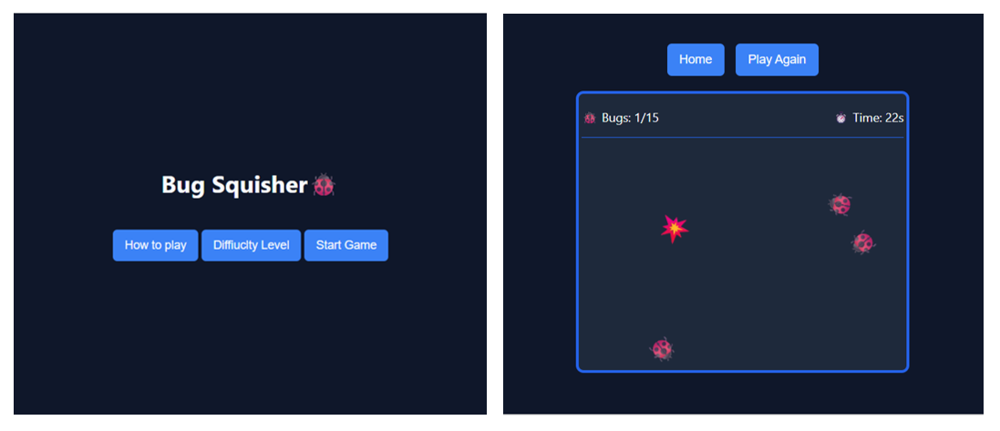

# 🐞 Bug Squisher

### Getting started
**Play the game** [Bugs Squisher](https://ashx73.github.io/Bug-Squisher-Project/)

**How to Play:** 
1. 🐞 Squish Bugs (+1 Point): Bugs pop up randomly across the grid. Click them fast to squish them and increase your score!
2. ⏱️ 30-Second Timer: Keeps track of your remaining sprint time.
3. 🎯 Target Score (15 Points): Hit this score before the timer hits zero to deploy clean code and win.

### Attributions / Credits
- **Sound Effects:** [Wet Splat Impact (`squish.mp3`)](https://pixabay.com/sound-effects/film-special-effects-wet-splat-impact-567197/) by [Universfield](https://pixabay.com/users/universfield-28281460/) via [Pixabay](https://pixabay.com/).
- **Icons & Game Logo:** Standard Unicode emojis (`🐞`, `💥`, `⏱️`, `🎯`).

### Technologies Used
- **HTML5**
- **CSS**
- **JavaScript**
- **Git & GitHub**

### Future Enhancements
- **Pop up Bombs:** Add bombs that randomly pop up on the grid—clicking one will deduct points or reduce the remaining sprint time.
- **Different Bug Types & Scoring:** Introduce multiple types of bugs with varying speeds and point values (e.g., regular bugs worth 1 point and rare "Critical Bugs" worth 3 points).
